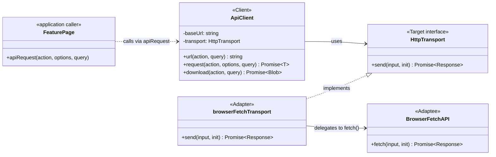

# Adapter Pattern Analysis

**Project:** EduTrack Student Information System  
**Course:** DCIT 26 - Application Development and Emerging Technologies  
**Date:** November 16, 2026  
**Group leader / project manager:** ______________________________  
**Group members:** ______________________________________________

## 1. Integration point

EduTrack sends browser requests to its PHP API through a small transport boundary. Feature code uses the action-oriented helpers exported from `lib/api.ts`. Those helpers delegate to `ApiClient`, which builds an endpoint URL, applies request options, and sends the request through the injected `HttpTransport`.

The concrete integration point selected here is the browser Fetch API. `ApiClient` expects a transport object with a `send(input, init)` method. Browser `fetch` is a standalone function, so it does not itself provide that object interface. `browserFetchTransport` supplies the expected method and forwards the arguments to `fetch`.

This is a deliberately small adapter: the Fetch API already accepts the same request and response types, while the adapter bridges the function-to-interface shape (`fetch(...)` to `transport.send(...)`). It does not change the PHP API protocol or make Fetch into a different HTTP client.

## 2. Adapter participant mapping

| Participant | EduTrack implementation | Responsibility |
| --- | --- | --- |
| **Client** | `ApiClient` in `lib/api-client.ts` | Needs an injectable `HttpTransport` and calls its `send` method to make requests. |
| **Target** | `HttpTransport` in `lib/http-transport.ts` | The interface the client expects: `send(input, init?) => Promise<Response>`. |
| **Adaptee** | Browser Fetch API (`fetch`) | Performs the actual browser HTTP request but is a function, rather than an object exposing the target's `send` method. |
| **Adapter** | `browserFetchTransport` in `lib/http-transport.ts` | Implements `HttpTransport`; its `send` method delegates to browser `fetch`. |

The application’s feature pages reach this boundary through `apiRequest` in `lib/api.ts`. The PHP endpoint at `http://localhost/edutrack-api/api.php` is the remote API destination; it is not the Adaptee in this particular pattern mapping.

## 3. Structural diagram



**Request path:** Feature page → `apiRequest` → `ApiClient.request` → `HttpTransport.send` → `browserFetchTransport.send` → browser `fetch` → PHP API.

## 4. Code example

The following excerpt follows the current implementation in `lib/http-transport.ts`, `lib/api-client.ts`, and `lib/api.ts` (types and unrelated request handling are shortened for readability).

```typescript
// Target: the interface ApiClient expects.
export interface HttpTransport {
  send(input: RequestInfo | URL, init?: RequestInit): Promise<Response>;
}

// Adaptee: the browser provides fetch(input, init), a function.
// Adapter: expose that function through the target's object method.
export const browserFetchTransport: HttpTransport = {
  send: (input, init) => fetch(input, init),
};

// Client: depends on the target, not directly on the browser global.
export class ApiClient {
  constructor(
    private readonly baseUrl: string,
    private readonly transport: HttpTransport,
  ) {}

  async request<T>(action: string, options: RequestInit = {}): Promise<T> {
    const url = new URL(this.baseUrl);
    url.searchParams.set("action", action);
    const response = await this.transport.send(url, {
      ...options,
      credentials: "include",
    });
    return response.json() as Promise<T>;
  }
}

// Composition in lib/api.ts wires the concrete adapter into the client.
const apiClient = new ApiClient(API_URL, browserFetchTransport);
```

In the full project, `ApiClient.request` also serializes query parameters, adds JSON headers when appropriate, parses response text, and converts failed responses into `ApiError`. `apiRequest` is the action-based helper used by feature pages; it delegates to this configured client.

## 5. Architectural benefit

The adapter keeps `ApiClient` dependent on the small `HttpTransport` target instead of calling the browser global directly. That separates request policy (building API URLs, credentials, headers, and errors) from the mechanism that sends a request. The current adapter is intentionally thin because Fetch already has compatible request and response types; its main job is to present Fetch through the injectable `send` contract.

This boundary supports the Open/Closed Principle at the transport seam: a different implementation, such as a test double or another transport, can implement `HttpTransport` and be supplied to `ApiClient` without changing feature pages or the client’s request logic. It also makes request behavior easier to test in isolation. The repository defines this seam, although this analysis does not claim that an automated transport test currently exists.

## Source files reviewed

- `lib/http-transport.ts` - target interface and browser adapter.
- `lib/api-client.ts` - client consuming the target.
- `lib/api.ts` - composition and application-facing helper functions.
- `lib/student-attendance-service.ts` - example feature service using `apiRequest`.
