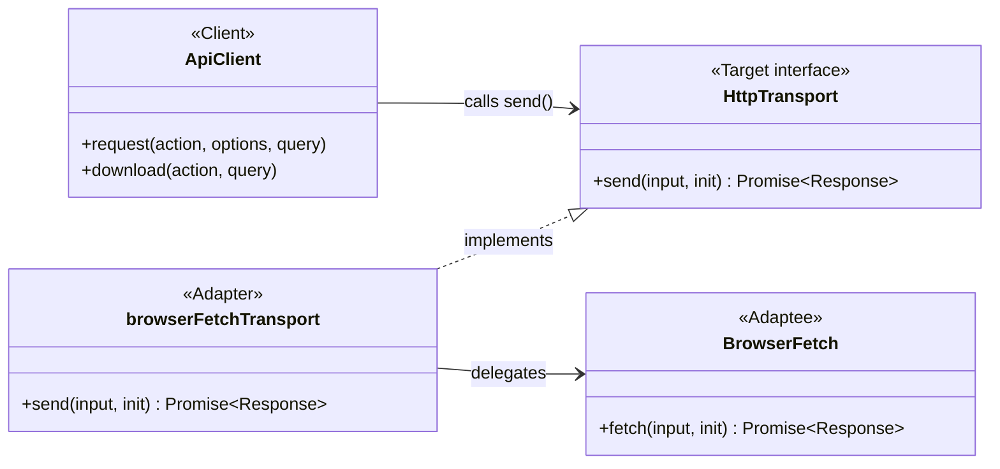
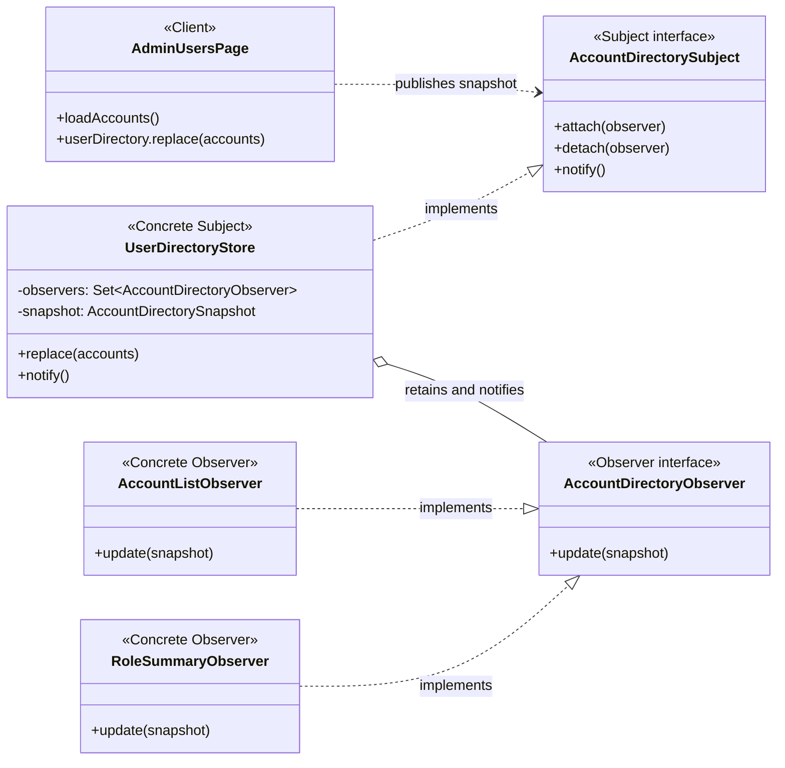
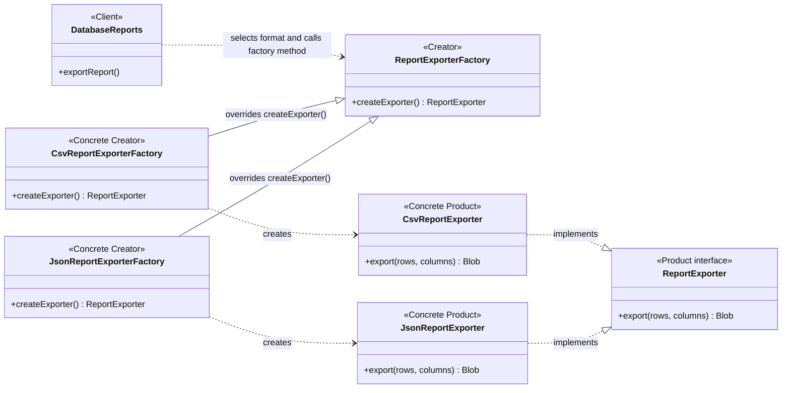

# Design Pattern Implementation in EduTrack

**Project:** EduTrack Student Information System  
**Course:** DCIT 26 - Application Development and Emerging Technologies  
**Date:** November 17, 2026  
**Group leader / project manager:** ______________________________  
**Group members:** ______________________________________________

EduTrack has three distinct pattern opportunities across its API, admin account directory, and report export modules. The HTTP transport Adapter and account-directory Observer are in use, and this implementation adds Factory Method to the report export flow. These patterns separate transport details, account-view updates, and export format construction from their callers.

## 1. Pattern opportunity audit

| Project area | Problem context | Candidate pattern and status | Expected benefit |
| --- | --- | --- | --- |
| API transport (`lib/api-client.ts`, `lib/http-transport.ts`) | `ApiClient` needs a consistent transport contract while the browser exposes requests through the concrete `fetch` function. | **Adapter** - already applied | Keeps API request behavior behind `HttpTransport`; the browser transport can be replaced without changing the client. |
| Admin user directory (`app/admin/users/page.tsx`) | After the API refreshes accounts, the account table and role summary totals both need the same new snapshot. | **Observer** - applied in this project | Publishes one account snapshot to separate views; additional views can subscribe without changing the subject. |
| Report export (`components/DatabaseReports.tsx`) | CSV serialization was embedded in the report component, tying the UI to one export format and its file construction. | **Factory Method** - implemented here | Lets the report UI request a product through a creator abstraction; CSV and JSON products can be added without putting their constructors in the UI. |

## 2. Pattern selection and justification

### Adapter

The transport boundary is a real integration point because API requests must eventually use the browser's concrete `fetch` function. `ApiClient` depends on the `HttpTransport` target, and `browserFetchTransport` adapts the browser function to that object's `send` contract. This matches the Adapter intent: the caller uses an expected interface while the concrete transport is wrapped behind it. It also supports dependency inversion because the client receives its transport rather than constructing or directly calling a browser-specific transport.

### Observer

The admin Users page has two independent views of the same account snapshot: the account table and the role summary cards. `UserDirectoryStore` is the subject; it publishes the refreshed snapshot to `AccountListObserver` and `RoleSummaryObserver` after API loads, account creation, or account status changes. This matches Observer's one-to-many notification intent and avoids making the subject know about either view. A future account view can attach through the observer interface without changing the store.

### Factory Method

Report exporting is a suitable creational pattern because each file format needs a different exporter product. The page now depends on the `ReportExporterFactory` creator contract and the `ReportExporter` product contract; concrete factories create CSV or JSON exporters. This follows Factory Method's intent of letting creator implementations choose the runtime product. Adding another format requires a new factory and exporter plus a registry entry, rather than adding product construction and serialization branches to the report component.

## 3. Structural diagrams

### Adapter for HTTP transport



### Observer for the admin account directory



### Factory Method for report export



## 4. Implementations

### Adapter

`ApiClient` is the client and `HttpTransport` is its target. `browserFetchTransport` implements the target by forwarding the request to the browser Fetch API, the adaptee. The configured client in `lib/api.ts` receives the adapter at construction.

```typescript
// Target
export interface HttpTransport {
  send(input: RequestInfo | URL, init?: RequestInit): Promise<Response>;
}

// Adapter around the browser's fetch(input, init) function
export const browserFetchTransport: HttpTransport = {
  send: (input, init) => fetch(input, init),
};

// Client receives the target implementation through dependency injection
export class ApiClient {
  constructor(
    private readonly baseUrl: string,
    private readonly transport: HttpTransport,
  ) {}

  async request<T>(action: string, options: ApiOptions = {}, query: Query = {}) {
    const response = await this.transport.send(this.url(action, query), {
      ...options,
      credentials: "include",
    });
    const responseBody = await response.text();
    let payload: unknown = null;
    try {
      payload = JSON.parse(responseBody);
    } catch {
      if (response.ok) throw new ApiError("EduTrack API returned an invalid response.", response.status);
    }
    if (!response.ok) throw this.responseError(payload, response.status);
    return payload as T;
  }
}

// Composition in lib/api.ts
const apiClient = new ApiClient(API_URL, browserFetchTransport);
```

### Observer

`UserDirectoryStore.replace()` replaces the current snapshot and calls `notify()`. The concrete observers implement the shared update contract but write to different React state setters. In the actual page, each observer is attached in a `useEffect` and detached in its cleanup function.

```typescript
export interface AccountDirectoryObserver {
  update(snapshot: AccountDirectorySnapshot): void;
}

export interface AccountDirectorySubject {
  attach(observer: AccountDirectoryObserver): void;
  detach(observer: AccountDirectoryObserver): void;
  notify(): void;
}

export class UserDirectoryStore implements AccountDirectorySubject {
  private readonly observers = new Set<AccountDirectoryObserver>();
  private snapshot: AccountDirectorySnapshot = {
    accounts: [],
    roleCounts: { student: 0, registrar: 0, admin: 0 },
  };

  attach(observer: AccountDirectoryObserver) { this.observers.add(observer); }
  detach(observer: AccountDirectoryObserver) { this.observers.delete(observer); }
  getSnapshot() { return this.snapshot; }

  replace(accounts: readonly DirectoryAccount[]) {
    const currentAccounts = [...accounts];
    this.snapshot = {
      accounts: currentAccounts,
      roleCounts: createRoleCounts(currentAccounts),
    };
    this.notify();
  }

  notify() {
    for (const observer of [...this.observers]) observer.update(this.snapshot);
  }
}

function createRoleCounts(accounts: readonly DirectoryAccount[]): RoleCounts {
  const counts: RoleCounts = { student: 0, registrar: 0, admin: 0 };
  for (const account of accounts) counts[account.role] += 1;
  return counts;
}

export class AccountListObserver implements AccountDirectoryObserver {
  constructor(private onUpdate: (accounts: readonly DirectoryAccount[]) => void) {}
  update(snapshot: AccountDirectorySnapshot) { this.onUpdate(snapshot.accounts); }
}

export class RoleSummaryObserver implements AccountDirectoryObserver {
  constructor(private onUpdate: (counts: RoleCounts) => void) {}
  update(snapshot: AccountDirectorySnapshot) { this.onUpdate(snapshot.roleCounts); }
}

// Client publishes a fresh API response; both attached observers update.
const result = await apiRequest<{ users: Account[] }>("admin_users");
userDirectory.replace(result.users);
```

### Factory Method

`ReportExporter` is the product interface; `ReportExporterFactory` is the creator. Each concrete factory overrides `createExporter()` to construct its format-specific product. The report component requests the chosen factory and works with the returned product without naming either concrete exporter class.

```typescript
export interface ReportExporter {
  readonly format: "csv" | "json";
  readonly mimeType: string;
  export(rows: readonly ReportRow[], columns: readonly string[]): Blob;
}

export abstract class ReportExporterFactory {
  abstract createExporter(): ReportExporter;
}

export class CsvReportExporterFactory extends ReportExporterFactory {
  createExporter(): ReportExporter { return new CsvReportExporter(); }
}

export class JsonReportExporterFactory extends ReportExporterFactory {
  createExporter(): ReportExporter { return new JsonReportExporter(); }
}

// Concrete Products
class CsvReportExporter implements ReportExporter {
  readonly format = "csv" as const;
  readonly mimeType = "text/csv;charset=utf-8";
  export(rows: readonly ReportRow[], columns: readonly string[]): Blob {
    const cell = (value: unknown) => `"${String(value ?? "").replaceAll('"', '""')}"`;
    const csv = [columns.map(cell).join(","), ...rows.map((row) => columns.map((column) => cell(row[column])).join(","))].join("\r\n");
    return new Blob([csv], { type: this.mimeType });
  }
}

class JsonReportExporter implements ReportExporter {
  readonly format = "json" as const;
  readonly mimeType = "application/json;charset=utf-8";
  export(rows: readonly ReportRow[], columns: readonly string[]): Blob {
    const data = rows.map((row) => Object.fromEntries(columns.map((column) => [column, row[column] ?? null])));
    return new Blob([JSON.stringify(data, null, 2)], { type: this.mimeType });
  }
}

const exporterFactories = {
  csv: new CsvReportExporterFactory(),
  json: new JsonReportExporterFactory(),
};
function getReportExporterFactory(format: "csv" | "json") { return exporterFactories[format]; }

// DatabaseReports client
const exporter = getReportExporterFactory(format).createExporter();
const file = exporter.export(rows, columns);
download(file, `${reportType}.${exporter.format}`);
```

## 5. Architectural impact

The Adapter keeps `ApiClient` dependent on an interface instead of a concrete transport, which applies dependency inversion and separates API request policy from the browser networking mechanism. The Observer keeps `UserDirectoryStore` focused on account state and notification; it does not depend on the table or role cards. The Factory Method separates exporter creation from report UI logic, so the client depends on the product abstraction and not constructors for CSV or JSON exporters.

The three patterns leave each module with a focused responsibility and reduce coupling between request handling, account views, and export formats. New transports, account views, and report formats can be added at their respective abstractions without rewriting existing callers, supporting the Open/Closed Principle and improving maintainability. Their abstractions also allow each boundary to be exercised independently with substitute implementations. In domain terms, EduTrack's account, API, and reporting workflows remain recognizable while the technical choices that serve them can vary behind stable interfaces.

## 6. Project repository

Repository: [github.com/PolPol24/edutrack](https://github.com/PolPol24/edutrack)

The implementation and this document are in the local working tree. They have not been pushed to GitHub yet, so the remote link will show them after the changes are published.

## Files containing the implementations

- `lib/http-transport.ts` and `lib/api-client.ts` - Adapter.
- `lib/user-directory-observer.ts` and `app/admin/users/page.tsx` - Observer.
- `lib/report-exporter-factory.ts` and `components/DatabaseReports.tsx` - Factory Method.
