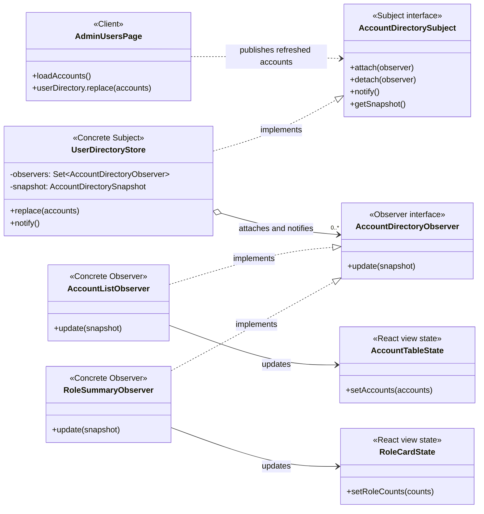

# Observer Pattern Analysis and Implementation

**Project:** EduTrack Student Information System  
**Course:** DCIT 26 - Application Development and Emerging Technologies  
**Date:** November 17, 2026  
**Group leader / project manager:** ______________________________  
**Group members:** ______________________________________________

## 1. Event driven scenario

The admin Users page loads the account directory from the PHP API. The directory is shown in two places: the account table and the summary cards for student, registrar, and admin accounts. Creating an account or changing an account's status triggers another API load, and both views must show the refreshed data.

**Subject:** The current account-directory snapshot managed by `UserDirectoryStore`.  
**Observers:** `AccountListObserver` refreshes the table data; `RoleSummaryObserver` refreshes the role totals.  
**Event / state change:** `userDirectory.replace(accounts)` publishes a newly fetched account list after the initial load or a successful create, suspend, or reactivate operation.  
**Problem addressed:** The earlier page updated a single `users` state directly and derived all view data from that component. As additional views need the same update, direct state wiring makes the page responsible for each view's refresh. The subject now publishes one snapshot to independently attached observers.

## 2. Observer participant mapping

| Participant | EduTrack implementation | Responsibility |
| --- | --- | --- |
| **Subject** | `AccountDirectorySubject` in `lib/user-directory-observer.ts` | Defines `attach`, `detach`, `notify`, and `getSnapshot` for account-directory observers. |
| **Observer interface** | `AccountDirectoryObserver` in `lib/user-directory-observer.ts` | Requires `update(snapshot)` when the directory changes. |
| **Concrete Subject** | `UserDirectoryStore` (`userDirectory` singleton) | Stores the latest accounts and role totals, then notifies attached observers from `replace`. |
| **Concrete Observers** | `AccountListObserver` and `RoleSummaryObserver` | Update separate React state for the account table and the three role summary cards. |
| **Client** | Admin Users page in `app/admin/users/page.tsx` | Loads accounts from the API and calls `userDirectory.replace(result.users)`; its view hooks attach the observers. |

## 3. Structural diagram



When the client publishes a snapshot, the Concrete Subject calls `update(snapshot)` on every attached Observer. Each Concrete Observer uses only the data relevant to its view.

## 4. Implementation excerpt

The implementation lives in `lib/user-directory-observer.ts`. The admin Users page attaches the two observer instances in React effects and detaches them when the page unmounts.

```typescript
export interface AccountDirectoryObserver {
  update(snapshot: AccountDirectorySnapshot): void;
}

export interface AccountDirectorySubject {
  attach(observer: AccountDirectoryObserver): void;
  detach(observer: AccountDirectoryObserver): void;
  notify(): void;
  getSnapshot(): AccountDirectorySnapshot;
}

function createRoleCounts(accounts: readonly DirectoryAccount[]): RoleCounts {
  const counts: RoleCounts = { student: 0, registrar: 0, admin: 0 };
  for (const account of accounts) counts[account.role] += 1;
  return counts;
}

export class UserDirectoryStore implements AccountDirectorySubject {
  private readonly observers = new Set<AccountDirectoryObserver>();
  private snapshot: AccountDirectorySnapshot = {
    accounts: [],
    roleCounts: { student: 0, registrar: 0, admin: 0 },
  };

  attach(observer: AccountDirectoryObserver) { this.observers.add(observer); }
  detach(observer: AccountDirectoryObserver) { this.observers.delete(observer); }
  getSnapshot() { return this.snapshot; }

  replace(accounts: readonly DirectoryAccount[]) {
    const currentAccounts = [...accounts];
    this.snapshot = {
      accounts: currentAccounts,
      roleCounts: createRoleCounts(currentAccounts),
    };
    this.notify();
  }

  notify() {
    for (const observer of [...this.observers]) observer.update(this.snapshot);
  }
}

export class AccountListObserver implements AccountDirectoryObserver {
  constructor(private onUpdate: (accounts: readonly DirectoryAccount[]) => void) {}
  update(snapshot: AccountDirectorySnapshot) { this.onUpdate(snapshot.accounts); }
}

export class RoleSummaryObserver implements AccountDirectoryObserver {
  constructor(private onUpdate: (counts: RoleCounts) => void) {}
  update(snapshot: AccountDirectorySnapshot) { this.onUpdate(snapshot.roleCounts); }
}

// Each view hook attaches its own Concrete Observer and detaches on cleanup.
const listObserver = new AccountListObserver(setAccounts);
const summaryObserver = new RoleSummaryObserver(setRoleCounts);
userDirectory.attach(listObserver);
userDirectory.attach(summaryObserver);

// Client call after the account list is fetched from the API.
const result = await apiRequest<{ users: Account[] }>("admin_users");
userDirectory.replace(result.users);
```

The page's `useAccountList` and `useRoleSummary` hooks each create and attach one Concrete Observer in a React effect, then detach it on cleanup. A replacement snapshot causes both React states to update, so the account table and role cards stay in sync after every reload.

## 5. Architectural benefit

`UserDirectoryStore` owns the account snapshot and notification flow. It does not know whether an observer updates a table, summary card, or another future view. Each observer has one presentation responsibility, while the admin page continues to own API calls and user actions. This separates the account state publisher from the views that depend on it and keeps each role cohesive.

The design supports the Open/Closed Principle at the notification seam: a new view can implement `AccountDirectoryObserver` and attach without changing the store or the existing observers. Explicit `attach` and `detach` also make subscriptions manageable across React mount and unmount. The subject can be exercised with small observer callbacks in isolation; this document does not claim that automated tests have been added or run.

## Source files

- `lib/user-directory-observer.ts` - Subject, Observer interface, Concrete Subject, and two Concrete Observers.
- `app/admin/users/page.tsx` - API refresh, subscription hooks, and account views.
